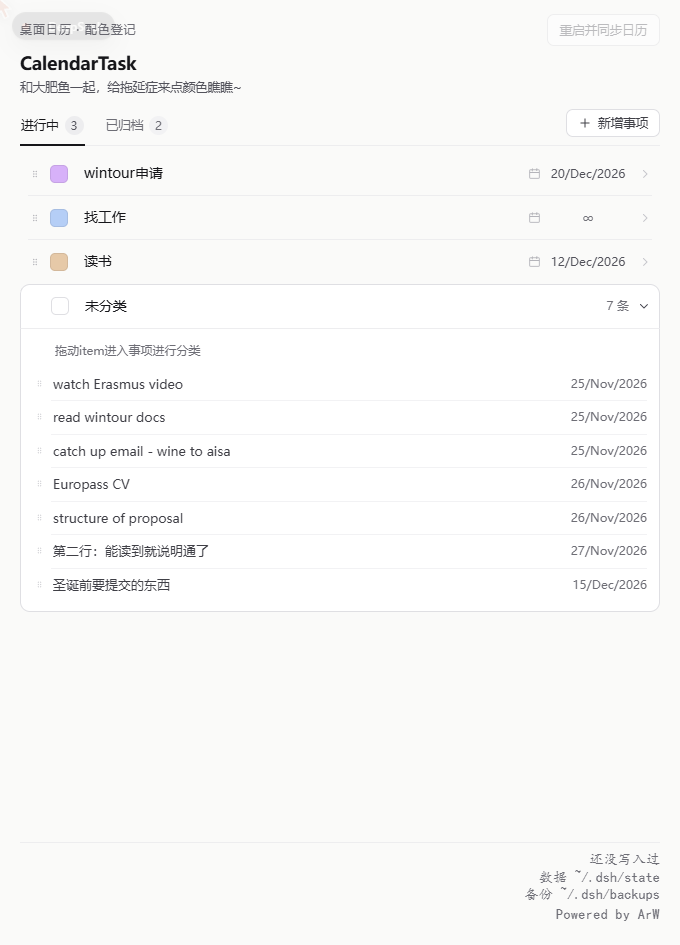
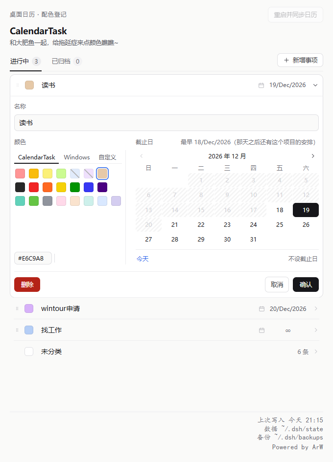

# CalendarTask · 桌面日历配色登记

给 Windows「桌面日历 DesktopCal」加一层**配色登记**：一件事一个颜色，颜色占着这个项目的时间段，截止日那天自动在格子上铺底色。计划写进日历，看颜色就知道每天在忙什么。



## 它解决什么问题

桌面日历本身能写字、能涂底色，但它不认识"项目"这回事：你没法一眼看出今天这行字属于哪个项目、那个项目的死线在几号、这个颜色是不是已经被别人占了。

这个项目补的就是这一层：

| 概念 | 是什么 | 在日历上长什么样 |
|---|---|---|
| **事项** | 一件事（项目），一个颜色 | 它名下的每一行文字都是这个颜色 |
| **截止日** | 可选；有死线才填 | 那天的**格子底色** |
| **倒数日** | 有截止日就自动建一条 | 桌面的倒数条里挂着 |
| **未分类** | 日历上有、还没归属的正文 | 默认色，等你拖进某个事项 |

颜色是**唯一身份**，所以同一个颜色不能同时给两件事；一个事项在截止日之前，它的颜色不能被别的事借走。

## 面板



- **收起**就是一行：色块 + 名称 + 截止日。除了拖动排序点不动别的，想改就展开。
- **展开**以后才能改名称、挑颜色（左边 22 色照抄 DesktopCal 自己的色板，右边是日期选择器，中间一条浅灰竖线），最下面是「删除 / 取消 / 确认」。
- 「未分类」是一个伪事项：展开后列出日历上所有还没有归属的正文，**行拖到哪个事项上就归谁**。
- 顶部「重启并同步日历」：写库之后点一下，桌面日历重启，改动立刻可见。
- 底栏：上次写入 / 数据目录 / 备份目录 / 署名。

## 安装

前提：Windows + [桌面日历 DesktopCal](https://www.desktopcal.com/) + DeepSeek Harness（DSH，带右侧栏）。

这个仓库同时是**技能目录**和**插件包**，所以只有两步：

```powershell
# 1. 仓库放在技能目录（DSH 从这里读 SKILL.md）
git clone https://github.com/Ar7Wei/dsh-calendartask.git "$env:USERPROFILE\.dsh\skills\desktopcal"

# 2. 链进 profile
cd "$env:USERPROFILE\.dsh\profiles\desktop"
pnpm add "link:$env:USERPROFILE\.dsh\skills\desktopcal"
```

再把 `@local/dsh-calendartask` 加进这个 `package.json` 的 `dsh.profile.bundles` 数组，重启 DSH。

重启后右侧栏右上角多一个日历图标，点它打开「CalendarTask」tab。没装插件也能用浏览器：面板服务单独跑起来就行 ——

```powershell
python "$env:USERPROFILE\.dsh\skills\desktopcal\panel\server.py" --port 8777
# 打开 http://localhost:8777
```

Python 用 DSH 自带的运行时，找不到就用 PATH 上的 `python`（3.9+）。

## 命令行

技能本体是 `desktopcal.py`，面板只是它的图形壳：

```powershell
python desktopcal.py list --month 2026-12
python desktopcal.py add-day 2026-12-01 "读《深度工作》" --color "#722F37" --ds
python desktopcal.py set-bg  2026-12-10 "#722F37"
python desktopcal.py add-countdown 2026-12-10 "读完《深度工作》" --color "#722F37" --ds
python desktopcal.py del-day 2026-12-05
python desktopcal.py backup / restore <文件> --yes / doctor
```

`--ds` 是"这行是我写的"标记：带 `-ds` 的可以自由增删改，不带的是你自己写的，工具**只读**。

## 数据放哪

| 文件 | 内容 |
|---|---|
| `%APPDATA%\CalendarTask\Db\calendar.db` | 桌面日历自己的库（我们读写它） |
| `~\.dsh\state\desktopcal-colors.json` | 活跃登记表：还没结束的事项 |
| `~\.dsh\state\desktopcal-colors-archive.json` | 归档：过期事项，只作留存 |
| `~\.dsh\state\desktopcal-released.json` | 删除时放掉的颜色及日期（租期用） |
| `~\.dsh\state\desktopcal-projection.json` | 上次投影的快照（drift 对比的底稿） |
| `~\.dsh\state\desktopcal-audit.log` | 每条写操作一行 |
| `~\.dsh\backups\desktopcal\` | 每次写库前的自动备份 |

## 安全网

这些不是装饰，都是踩过坑之后加的：

- **写前备份**：每次真正写库前复制一份 `calendar.db`。
- **`-ds` 边界**：`del-day` 遇到不是你写的正文会拒绝并列出来，`--force` 才硬闯。
- **防误删**：登记表空、库里却还有我们建的倒数日 → 投影直接抛错，不执行（防"JSON 写坏了把日历清空"）。
- **颜色租期**：清理只动"当前租期内"的行，不碰更早的历史。
- **并发写**：面板保存带 `rev`，另一个窗口改过就 409，让你选「重新加载」还是「覆盖它」。
- **归档收投影**：事项过期进归档时，收掉它的倒数日和底色，但**保留**你写在那几格里的文字。
- **归档只作留存**：读的时候只读活跃表，所以工作集不随历史膨胀。

## 测试

第 0 层是集成测试：真的写日历库，**但对着副本写** —— 跑之前自动复制库、造一个空的状态目录，跑完删掉。

```powershell
python tests/run.py --log out.txt
```

78 项断言（库读写 / 投影 / 撞色 / 防误删 / 归档收投影）。测试只用 2027 年的空日子；如果你那几天本来就有内容，换一个测试日再跑。

## 已知限制

- 只支持 Windows + DesktopCal 的原生库；换日历软件要重写 `projection.py`。
- 写库之后要重启桌面日历才看得见（它是启动时读库）。
- 「认领」（把未分类的行挂到事项上）没有反向操作，想撤回得去 DesktopCal 里手改。
- 日期选择器只支持 Esc 关闭，方向键 / Enter 还没接。
- 正文里如果有 `|单字|` 这种竖线夹单字的写法，会被 DesktopCal 的转义约定吃掉。

## 目录

```
client.js            面板 UI（DSH 侧栏与本地页面共用这一份）
index.js             插件宿主：拉起本地服务
panel/server.py      本地服务（REST + 静态页）
panel/projection.py  登记表 → 日历库的投影（核心逻辑）
panel/index.html     浏览器里挂载同一个 client.js
desktopcal.py        命令行
guard.py             校验规则（只有这一份）
SKILL.md             技能说明（给 agent 看的操作手册）
docs/HANDOFF.md      设计取舍、踩坑记录、测试过程（很长的现场笔记）
tests/               第 0 层集成测试
```

## 许可

MIT。第三方：`panel/vendor/` 下的 React / ReactDOM 是 Meta 的 MIT 构建产物。
